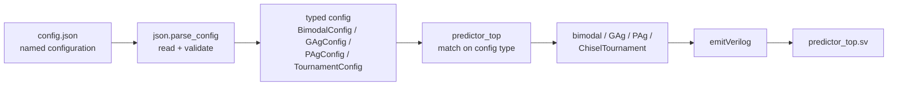
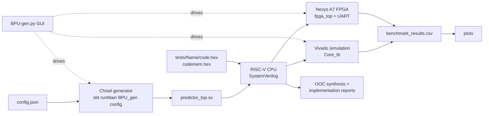
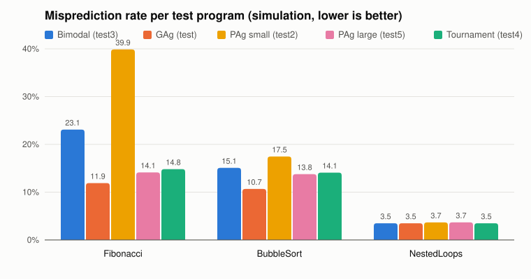
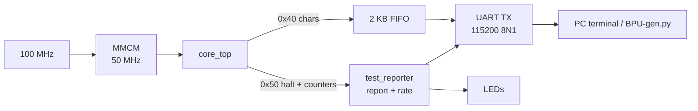
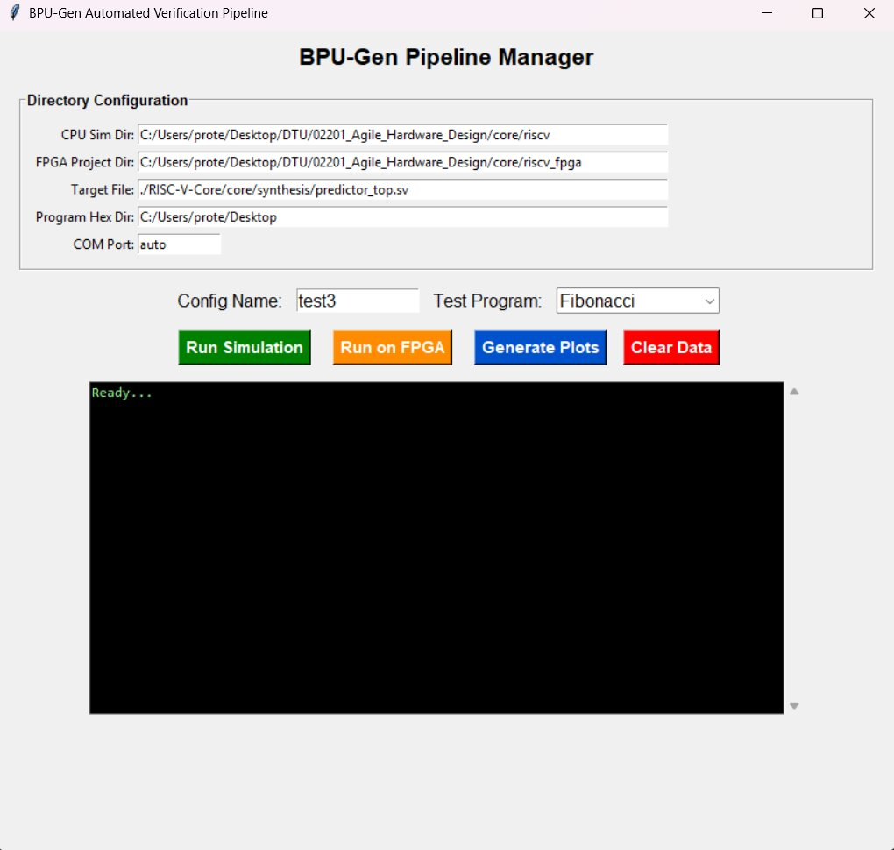

# BPU-Gen: Parameterized Branch Predictor Generator

## Project Description
**BPU-Gen** is a configurable hardware generator for Branch Predictor Units (BPUs), written in Chisel.

In CPU pipelines, branch predictors guess the outcome of branches so the processor does not have to wait for them. BPU-Gen creates different branch predictors (Bimodal, GAg, PAg, Tournament) from a few settings in a JSON file. The generated Verilog is plugged into a 5-stage RV32I RISC-V CPU, measured in simulation and on a Nexys A7 FPGA, and compared automatically by a Python tool with a GUI.

**Contents**
1. [BPU-Gen: the generator in Chisel](#1-bpu-gen-the-generator-in-chisel)
2. [System overview](#2-system-overview)
3. [Integration into the RISC-V CPU](#3-integration-into-the-risc-v-cpu)
4. [Test programs](#4-test-programs)
5. [Metrics: what is measured and how](#5-metrics-what-is-measured-and-how)
6. [Results](#6-results)
7. [Running on the FPGA](#7-running-on-the-fpga)
8. [The GUI: BPU-gen.py](#8-the-gui-bpu-genpy)
9. [Requirements](#9-requirements)
10. [How to run](#10-how-to-run)
11. [Repository structure](#11-repository-structure)
12. [AI usage](#12-ai-usage)
13. [Development Methodology](#development-methodology)
14. [Planning](#planning)

---

## 1. BPU-Gen: the generator in Chisel

### 1.1 Why a generator?
A hand-written branch predictor in Verilog is one fixed design: its table size, counter width and history length are hard-coded, and trying another variant means rewriting and re-verifying the RTL.

BPU-Gen instead describes **families** of predictors as parameterized Chisel (Scala) classes. One command turns a named configuration into a concrete Verilog module:

```
sbt "runMain BPU_gen test3"      ->   predictor_top.sv
```

Changing one line in `config.json` (say, a 128-entry table instead of 1024, or 3-bit instead of 2-bit counters) gives different hardware with the same interface, checked by the same unit tests, and ready to drop into the CPU. This is what makes the design-space exploration in [Results](#6-results) possible: every bar in the chart is a different generated predictor in the same CPU.

### 1.2 From JSON to Verilog



1. **Parse and validate** ([json.scala](BPU-gen/src/main/scala/help/json.scala)): the named configuration is read with uPickle and checked (missing keys, sizes that are not powers of two, counter widths that are too small, unknown algorithms). Errors stop generation with a readable message instead of producing broken hardware.
2. **Typed configuration:** each algorithm has its own Scala `case class` (`BimodalConfig`, `GAgConfig`, `PAgConfig`, `TournamentConfig`), all extending one `sealed trait bpu_config`. The compiler knows exactly which parameters exist for which algorithm.
3. **Select the predictor** ([predictor_top.scala](BPU-gen/src/main/scala/predictor_core/predictor_top.scala)): `predictor_top` pattern-matches on the configuration type and instantiates the matching predictor. It also creates plain `clk`/`rst` ports and applies the CPU's reset polarity (`active_low_reset`), so the CPU always sees the same top-level module.
4. **Elaborate** ([BPU_gen.scala](BPU-gen/src/main/scala/BPU_gen.scala)): `emitVerilog(new predictor_top(config))` runs the Scala code, which computes all widths and sizes, and writes `predictor_top.sv`.

### 1.3 Chisel features the generator relies on

| Feature | Where | What it gives |
|---|---|---|
| Scala parameters evaluated at elaboration | all predictors | widths and sizes are computed, not hard-coded: `log2Ceil(pht_size)` index bits, counter maximum `(1 << counter_width) - 1` |
| Abstract base class `base_predictor` with a shared IO bundle | [base_predictor.scala](BPU-gen/src/main/scala/predictor_core/base_predictor.scala), [predictor_io.scala](BPU-gen/src/main/scala/interface/predictor_io.scala) | every predictor is interchangeable; the CPU never changes when the algorithm changes |
| `RawModule` + `withClockAndReset` | `predictor_top` | explicit `clk`/`rst` ports and configurable reset polarity |
| `RegInit(VecInit(...))` for small state | PAg history table, GAg history register | registers with a reset value, for state that is small and read every cycle |
| `loadMemoryFromFileInline` | [pht_init.scala](BPU-gen/src/main/scala/predictor_core/pht_init.scala) | known start values for the tables in simulation (see below) |
| Module composition | [ChiselTournament.scala](BPU-gen/src/main/scala/predictor_core/ChiselTournament.scala) | the Tournament predictor reuses the Bimodal and GAg modules as building blocks |
| `require(...)` checks | GAg, PAg, Tournament | impossible parameter combinations fail at generation time |

A complete predictor is short. The core of the Bimodal predictor:

```scala
class bimodal(val config: BimodalConfig) extends base_predictor(config.address_width) {
  val indexBits = log2Ceil(config.pht_size)
  val pht = Mem(config.pht_size, UInt(config.counter_width.W))    // the counter table
  pht_init(pht, config.pht_size)                                   // all counters start at 0

  // predict: MSB of the counter selected by the fetch PC
  io.prediction_o := pht(io.read_addr_i(indexBits + 1, 2))(config.counter_width - 1)

  // train: saturating +1 / -1 at the PC of the resolved branch
  when (io.br_cntrl_i.i_addr =/= 0.U) { ... }
}
```

**Table start values.** `Mem` has no reset. `pht_init` writes `pht_init/pht_init_<size>.hex` (all zeros = strongly not-taken), and the generated Verilog loads it with `$readmemh` in simulation. On the FPGA, RAM starts at zero anyway, so simulation and hardware begin from the same state.

### 1.4 Configuration (`config.json`)
The root holds settings shared by all configurations; every other key is a named configuration.

```json
{
  "address_width": 32,
  "active_low_reset": true,
  "test":  { "algorithm": "GAg", "pattern_history_table_size": 1024, "counter_width": 2, "ghr_size": 10, "pc_bits": 0 },
  "test2": { "algorithm": "PAg", "pattern_history_table_size": 4, "counter_width": 2,
             "history_table_width": 2, "history_table_size": 4 },
  "test3": { "algorithm": "Bimodal", "pattern_history_table_size": 128, "counter_width": 2 },
  "test4": { "algorithm": "Tournament", "choice_table_size": 1024, "choice_counter_width": 2,
             "local_pht_size": 128, "local_counter_width": 2,
             "global_pht_size": 128, "global_ghr_size": 10, "global_counter_width": 2 }
}
```

| Algorithm | Parameter | Meaning | Checks |
|---|---|---|---|
| (all) | `address_width` | PC width of the CPU (e.g. 32 or 64) | required |
| (all) | `active_low_reset` | reset polarity of the CPU (optional, default `false`) | |
| Bimodal | `pattern_history_table_size` | number of counters | > 0 |
| | `counter_width` | bits per saturating counter | > 0 |
| GAg | `pattern_history_table_size` | number of counters | power of two, ≥ 2 |
| | `counter_width` | bits per counter | ≥ 2 |
| | `ghr_size` | global history register length | ≥ index bits from history |
| | `pc_bits` | PC bits added to the index (0 = pure GAg) | optional, ≥ 0 |
| PAg | `pattern_history_table_size` | number of counters in the shared table | power of two, ≥ 2 |
| | `counter_width` | bits per counter | ≥ 2 |
| | `history_table_size` | number of per-branch history registers (selected by PC bits) | power of two |
| | `history_table_width` | length of each history register | ≥ 2 and ≥ log2(`pattern_history_table_size`) |
| Tournament | `choice_table_size`, `choice_counter_width` | chooser table | power of two, width ≥ 2 |
| | `local_pht_size`, `local_counter_width` | Bimodal part | power of two, width ≥ 2 |
| | `global_pht_size`, `global_ghr_size`, `global_counter_width` | GAg part | power of two, width ≥ 2 |

### 1.5 Interface
Every predictor has the same IO ([predictor_io.scala](BPU-gen/src/main/scala/interface/predictor_io.scala)), matching the CPU's `br_cntrl_bus_t`:

| Port | Dir | Meaning |
|---|---|---|
| `read_addr_i` | in | PC of the instruction being fetched |
| `prediction_o` | out | 1 = predict taken (combinational, same cycle) |
| `br_cntrl_i.branch_resolved` | in | a conditional branch is resolved in the execute stage this cycle |
| `br_cntrl_i.i_addr` | in | PC of that branch |
| `br_cntrl_i.is_taken` | in | its actual outcome |

### 1.6 Predictors

| Predictor | Index | Prediction | Training (when a branch resolves) |
|---|---|---|---|
| **Bimodal** ([bimodal.scala](BPU-gen/src/main/scala/predictor_core/bimodal.scala)) | `PC[log2(size)+1 : 2]` | MSB of the counter | counter ±1 (saturating) at the branch's own PC |
| **GAg** ([GAg.scala](BPU-gen/src/main/scala/predictor_core/GAg.scala)) | global history (+ optional PC bits) | MSB of the counter | counter ±1 at the history index, then the outcome is shifted into the history register |
| **Tournament** ([ChiselTournament.scala](BPU-gen/src/main/scala/predictor_core/ChiselTournament.scala)) | chooser: `PC[...]` | Bimodal's or GAg's prediction, chosen by the chooser counter's MSB | both sub-predictors train; the chooser moves towards the one that was right when they disagree |
| **PAg** ([PAg.scala](BPU-gen/src/main/scala/predictor_core/PAg.scala)) | history register selected by `PC[log2(hist_size)+1 : 2]`; its value indexes the shared table | MSB of the counter | counter ±1 at that history's index, then the outcome is shifted into *that branch's* history register |

* **Bimodal** learns the usual direction of *each branch* separately. Simple and small, but it cannot learn patterns.
* **GAg** indexes one shared table with the outcomes of the *last N branches* (global history), so it can learn patterns that depend on what happened just before, such as the recursion in Fibonacci.
* **PAg** keeps a separate history for each branch (per-address history) and uses it to index one shared table. It learns patterns of *one branch on its own*, such as "taken, taken, taken, not taken" at the end of a short loop, which a global history mixes up with all other branches.
* **Tournament** runs both and learns, per branch address, which of the two to trust.

### 1.7 What comes out
E.g for `test3` the generator writes `predictor_top.sv` with three modules:

| Module | Content |
|---|---|
| `pht_128x2` | the 128 × 2-bit counter table (from `Mem`), with the `$readmemh` start values |
| `bimodal` | read and training logic |
| `predictor_top` | the ports the CPU connects to: `clk`, `rst`, `io_read_addr_i`, `io_prediction_o`, `io_br_cntrl_i_*` |

### 1.8 Adding a new predictor
1. Write a class that extends `base_predictor` (same IO as all others).
2. Add a `case class` for its parameters that extends `bpu_config` ([json.scala](BPU-gen/src/main/scala/help/json.scala)).
3. Add a `case "<Name>" =>` branch in `parse_config` that reads and checks its parameters.
4. Add a `case` line in `predictor_top` that instantiates it.
5. Add a ChiselTest spec and register it in `get_test_class` in [BPU-gen.py](BPU-gen/BPU-gen.py).

The CPU, the scripts and the GUI need no changes. Possibilities are endless!!

### 1.9 Unit tests (ChiselTest)

| Test | Checks |
|---|---|
| [BimodalTest](BPU-gen/src/test/scala/BimodalTest.scala) | counter training, saturation, prediction flip at the MSB |
| [GAgSpec](BPU-gen/src/test/scala/GAgTest.scala) | history-only indexing, training only on `branch_resolved`, PC bits in the index |
| [PAGTest](BPU-gen/src/test/scala/PAGTest.scala) | not-taken after reset, no update without `branch_resolved`, learns always-taken / always-not-taken, perfectly predicts an alternating pattern, separate histories per entry, aliasing above the index bits, recovery after a pattern change |
| [TournamentSpec](BPU-gen/src/test/scala/TournamentSpec.scala) | starts not-taken, learns a taken branch |

The GUI runs the matching test automatically before generating (`sbt "testOnly <Spec>"`), and stops if it fails.

---

## 2. System overview



One button in [BPU-gen.py](BPU-gen/BPU-gen.py) runs the whole chain for a chosen configuration and test program: Chisel unit test → generate Verilog → copy it into the CPU → load the test program → simulate (or build, program and read the FPGA) → append the results to the CSV.

---

## 3. Integration into the RISC-V CPU

The CPU ([RISC-V-Core/core](BPU-gen/RISC-V-Core/core)) is a 5-stage RV32I pipeline (no multiply/divide) with forwarding, written in SystemVerilog. The generated `predictor_top.sv` replaces the old hand-written predictor in [core_top.sv](BPU-gen/RISC-V-Core/core/simulation/core_top.sv):

```verilog
(* keep_hierarchy = "yes" *)
predictor_top predictor_top (
    .clk(clk), .rst(rst),
    .io_read_addr_i(pc),                                     // fetch PC
    .io_prediction_o(prediction),
    .io_br_cntrl_i_is_taken(br_bus.is_taken),                // from the execute stage
    .io_br_cntrl_i_i_addr(br_bus.i_addr),
    .io_br_cntrl_i_branch_resolved(br_bus.branch_resolved));
```

**How a prediction is used.** A branch is fetched early from its target only if the predictor says *taken* **and** the branch target buffer (BTB) knows the target (`prediction = pred_i && BTB hit`). The branch is resolved in the execute stage; on a misprediction the pipeline is flushed and fetching restarts at the correct address.

**Memories**

| Memory | Size | Implementation | Read |
|---|---|---|---|
| Instruction memory | 16 KB (4096 × 32) | 4 block RAMs | synchronous (address = next PC) |
| Data memory | 16 KB (4096 × 32) | 4 block RAMs, byte writes | synchronous (address from execute stage) |
| BTB | 4096 entries × 64 bit | LUT-RAM (dual port) | asynchronous (same cycle as fetch) |
| Register file | 32 × 32 | LUT-RAM | asynchronous |
| Predictor tables | per config | LUT-RAM (Chisel `Mem`) | asynchronous |

**Memory map** (from [sim.ld](BPU-gen/RISC-V-Core/code/common/sim.ld)): code at `0x0000` (start `0x100`), data at `0x8000`, stack at the end of data memory. A store to **`0x40`** prints a character, a store to **`0x50`** ends the program with its return value (`main()`'s return value is written there by [crt0.s](BPU-gen/RISC-V-Core/code/common/crt0.s)).

---

## 4. Test programs

Each test is a folder in [tests/](BPU-gen/tests) with its compiled memory images. The GUI lists every folder that has both hex files; before a run, the selected test's `code.hex` / `codemem.hex` are copied to where the CPU loads them from.

| Test | Source | What it does | Branch behaviour | Result |
|---|---|---|---|---|
| Fibonacci | [fib.c](BPU-gen/tests/Fibonacci/fib.c) + printf | recursive fib(1…10), prints the series | irregular (recursion) | returns 55 (because of recursion and reported as FAIL, since ≠ 0) |
| BubbleSort | [bubblesort.c](BPU-gen/tests/BubbleSort/bubblesort.c) | sorts 64 pseudo-random numbers, checks the result | data-dependent compare | returns 0 = PASS |
| NestedLoops | [nested_loops.c](BPU-gen/tests/NestedLoops/nested_loops.c) | 16×16 matrix add + sum, 8 rounds, checks the total | regular loops | returns 0 = PASS |

---

## 5. Metrics: what is measured and how

The counters live in hardware ([metrics_cntrl.sv](BPU-gen/RISC-V-Core/core/synthesis/metrics_cntrl.sv)) and are identical in simulation and on the FPGA:

| Metric | Counted when |
|---|---|
| Instructions Executed | a real instruction (not a stall bubble or flushed slot) passes the memory stage |
| Conditional | a conditional branch is resolved in the execute stage (exactly once per branch) |
| Jumps | a JAL/JALR passes the memory stage |
| Total Branches | Conditional + Jumps |
| Mispredicted | a conditional branch whose outcome differs from the prediction the pipeline actually used |
| **Mispred Rate** | Mispredicted / Conditional × 100 |

The counters are frozen at the first write to `0x50` (after `main()` returns the startup code loops forever). Jumps are not part of the rate.

---

## 6. Results

### 6.1 Prediction accuracy



Misprediction rate in simulation (from [benchmark_results.csv](BPU-gen/benchmark_results.csv)):

| Predictor (config) | Fibonacci | BubbleSort | NestedLoops |
|---|---|---|---|
| Bimodal, 128 entries, 2-bit (`test3`) | 23.10 % | 15.08 % | 3.49 % |
| GAg, 1024 entries, 10-bit history, 2-bit (`test`) | **11.90 %** | **10.67 %** | 3.49 % |
| PAg small, 4 histories × 2 bit, 4 entries, 2-bit (`test2`) | 39.87 % | 17.46 % | 3.66 % |
| PAg large, 256 histories × 10 bit, 1024 entries, 2-bit (`test5`) | 14.13 % | 13.77 % | 3.68 % |
| Tournament, Bimodal 128 + GAg 128, 1024-entry chooser (`test4`) | 14.82 % | 14.09 % | 3.49 % |

Number of branches per program (the same for every predictor):

| Test | Instructions | Conditional branches | Jumps (JAL/JALR) |
|---|---|---|---|
| Fibonacci | 28,884 | 2,874 | 2,792 |
| BubbleSort | 68,014 | 4,451 | 9,114 |
| NestedLoops | 102,547 | 4,725 | 13,794 |

**What the numbers show**
* **Fibonacci** (recursive) has irregular branches: whether `n == 0` or `n == 1` depends on the position in the recursion tree. A per-branch counter (Bimodal) gets 23 % wrong; GAg, which uses the global history of recent branches, halves that (11.9 %).
* **BubbleSort** has a data-dependent compare. History helps less (15 % → 10.7 %).
* **NestedLoops** gives exactly 165 mispredictions for Bimodal, GAg and Tournament: that is exactly the number of *taken* conditional branches (the loop exits). Every loop exit is mispredicted and everything else is right. The loops run 16 times, and a 10-bit global history cannot see far enough back to predict the 16th iteration.
* **Size matters a lot for PAg.** The small PAg (`test2`) has only 4 history registers, selected by 2 PC bits, and a 4-entry table, so all branches share the same few histories and counters and keep overwriting each other's state (aliasing): it is the worst predictor (39.9 % on Fibonacci). The large PAg (`test5`, 256 histories × 10 bit, 1024 entries) is almost **3 × better on Fibonacci (14.1 %)** and beats Bimodal and the Tournament on both irregular programs, but not GAg: in these programs the outcome of a branch depends more on the *other* branches just before it (the global history) than on its own past.
* **PAg does not learn the loop exits either** (174 misses on NestedLoops). The table index uses only 10 history bits, while the loops run 16 and 256 times, so a branch's history looks the same ("all not taken") before the exit as in the middle of the loop. Seeing a 16-iteration exit would need at least 16 history bits, i.e. a 65,536-entry table.
* **The Tournament does not beat GAg alone.** Two reasons: its GAg part is smaller (128 entries, so 7 history bits are used instead of 10), and its chooser is trained with the sub-predictors' outputs for the instruction being *fetched* in that cycle rather than for the branch being resolved, so it often picks the wrong side.
* **GAg is the best of the measured predictors** on both irregular programs, followed by the large PAg; on regular loops all are about equal.

<!-- PHOTO: plots generated by the GUI ("Generate Plots", benchmark_plots/), e.g.

-->

### 6.2 Hardware cost

Out-of-context runs of the complete CPU (`core_synth_top`), Vivado 2025.1, xc7a100tcsg324-1, 100 MHz constraint, configuration `test3` (Bimodal, 128 × 2-bit):

| Resource | Used | Available | Utilization |
|---|---|---|---|
| **Slices** | 2,440 | 15,850 | **15.4 %** |
| LUTs | 9,030 | 63,400 | 14.2 % |
| ↳ logic | 3,346 | | 5.3 % |
| ↳ LUT-RAM | 5,684 | 19,000 | 29.9 % |
| Flip-flops | 555 | 126,800 | 0.4 % |
| Block RAM (36 Kb) | 8 | 135 | 5.9 % |
| DSP | 0 | 240 | 0 % |

| Timing / power | Value |
|---|---|
| Worst setup slack @ 100 MHz | −4.233 ns → **Fmax ≈ 70.3 MHz** (synthesis estimate 70.4 MHz) |
| Worst hold slack | +0.095 ns (met) |
| Power | 0.160 W total (0.076 W dynamic, 0.084 W static; vectorless estimate) |

**Area by module** (LUTs): BTB 6,748 (5,632 of them LUT-RAM) · decode stage 1,238 · memory stage 659 (+4 block RAM) · fetch stage 223 (+4 block RAM) · execute stage 103 · glue 67. **About 60 % of all LUTs is the BTB**;

**Critical path:** load data out of the data block RAM → load alignment → forwarded to the execute stage → branch comparison → BTB write enable (fan-out to 88 BTB RAM cells), 13.3 ns. It does not go through the predictor.

Results for the other configurations are produced the same way (see [How to run](#10-how-to-run), step 3).

---

## 7. Running on the FPGA

Board: **Digilent Nexys A7-100T / Nexys 4 DDR** (xc7a100tcsg324-1). Files in [RISC-V-Core/core/fpga](BPU-gen/RISC-V-Core/core/fpga).



* The CPU runs at **50 MHz** (its Fmax is about 70 MHz).
* Everything the program prints goes to the USB-UART while it runs.
* When the program writes `0x50`, the counters are frozen and a report is sent:

```
==== RISC-V core FPGA test ====
result         : FAIL
exit code      : 55
cycles         : …
instructions   : 28885
cond. branches : 2874
jumps          : 2792
mispredicted   : 664
mispred. rate  : 23.10 %
================================
```
(Bimodal `test3` running Fibonacci; the same numbers as the simulation)

| LED | Meaning |
|---|---|
| LD0 | heartbeat (clock running) |
| LD1 / LD2 | running / finished |
| LD3 / LD4 / LD5 | PASS / FAIL / TIMEOUT (no `0x50` write within 10 s) |
| LD6 | console characters were dropped (FIFO full) |
| LD7 | UART busy |
| LD15..LD8 | PASS: misprediction rate in whole percent; FAIL: return value [7:0] |
| RGB LD16 | blue running, green PASS, red FAIL/TIMEOUT |

Buttons: **BTNC** prints the report again, **CPU_RESET** restarts the CPU (memories are not reloaded; re-program the FPGA for a clean run).

| File | Purpose |
|---|---|
| [fpga_top.sv](BPU-gen/RISC-V-Core/core/fpga/fpga_top.sv) | board top level: clock, reset, CPU, FIFO, report, LEDs |
| [test_reporter.sv](BPU-gen/RISC-V-Core/core/fpga/test_reporter.sv) | formats the report, divider for the rate |
| [uart_tx.sv](BPU-gen/RISC-V-Core/core/fpga/uart_tx.sv), [byte_fifo.sv](BPU-gen/RISC-V-Core/core/fpga/byte_fifo.sv) | UART transmitter, character buffer |
| [nexys_a7.xdc](BPU-gen/RISC-V-Core/core/fpga/nexys_a7.xdc) | pins and clock |
| [fpga_tb.sv](BPU-gen/RISC-V-Core/core/fpga/fpga_tb.sv) | simulates the board and decodes the UART (also works post-synthesis) |

---

## 8. The GUI: BPU-gen.py

[BPU-gen.py](BPU-gen/BPU-gen.py) is a Tkinter GUI that runs the full flow.



| Field | Meaning |
|---|---|
| CPU Sim Dir | Vivado project used for simulation (`riscv.xpr`) |
| FPGA Project Dir | Vivado board project (`riscv_fpga.xpr`) |
| Target File | where the generated `predictor_top.sv` is copied (`RISC-V-Core/core/synthesis/`) |
| Program Hex Dir | folder the CPU loads `code.hex` / `codemem.hex` from. (instructions and datamem) |
| COM Port | board UART (`auto` finds the Nexys board) |
| Config Name | configuration from `config.json` |
| Test Program | dropdown of the tests in `tests/` |

| Button | Steps |
|---|---|
| **Run Simulation** | 1 ChiselTest for the algorithm → 2 `sbt runMain BPU_gen <config>` → 3 copy `predictor_top.sv` into the CPU → 4 load the test program → 5 Vivado batch simulation ([run_sim.tcl](BPU-gen/run_sim.tcl)) → 6 parse the metrics, append a `Simulated` row |
| **Run on FPGA** | steps 1–4, then build the bitstream ([build_fpga.tcl](BPU-gen/build_fpga.tcl), stops if timing is not met) → open the COM port → program ([program_fpga.tcl](BPU-gen/program_fpga.tcl)) → read the UART report → append an `FPGA` row (nothing is added on TIMEOUT) |
| **Generate Plots** | one bar chart per platform and test in `benchmark_plots/` |
| **Clear Data** | empties the CSV |

CSV columns: `Config, Algorithm, Test, Platform, Instructions Executed, Total Branches, Conditional, Jumps, Mispredicted, Mispred Rate`. Vivado's output of FPGA runs is kept in `fpga_build.log` / `fpga_program.log` in the FPGA project folder.

---

## 9. Requirements

**Software**

| Tool | Version used | For |
|---|---|---|
| JDK + sbt | Scala 2.13.16 | building the generator |
| Chisel / ChiselTest / uPickle | 6.7.0 / 6.0.0 / 3.1.0 | generator, unit tests, JSON ([build.sbt](BPU-gen/build.sbt)) |
| Vivado | 2025.1 | simulation, synthesis, implementation, programming |
| Python 3 | 3.14 | `BPU-gen.py` (Tkinter, `matplotlib`, `pyserial` for FPGA runs) |
| RISC-V compiler (optional) | `pip install ziglang` | only to build new test programs |
| Serial terminal (optional) | PuTTY, 115200 8N1 | watching the board by hand |

**Hardware:** Digilent Nexys A7-100T (or Nexys 4 DDR) and a micro-USB cable (programming and UART on the same port).

---

## 10. How to run

> All commands run inside the `BPU-gen/` folder (where `build.sbt` and `BPU-gen.py` are). Paths such as `C:/Users/prote/...` (Vivado path, hex directory, project folders) are set as defaults in `BPU-gen.py` and in `if_stage.sv` / `mem_stage.sv`; change them for your machine.

**1. Generator only**
```
cd BPU-gen
sbt "runMain BPU_gen test3"          # writes predictor_top.sv
sbt "testOnly BimodalTest"           # unit tests: BimodalTest, GAgSpec, PAGTest, TournamentSpec
```

**2. Benchmarks with the GUI**
```
cd BPU-gen
pip install matplotlib pyserial
python BPU-gen.py
```
Choose the configuration and the test program, then **Run Simulation** and/or **Run on FPGA** (board connected, no terminal program using the COM port). **Generate Plots** draws the results.

**3. Area / timing / power reports for a configuration**
1. Run Simulation for the configuration (this generates its `predictor_top.sv`).
2. In the `riscv` project: Reset `synth_1` → Run Implementation.
3. Tcl console: `set report_tag test3` and `source <path to>/BPU-gen/RISC-V-Core/core/reports.tcl`.

---

## 11. Repository structure

```
BPU/
├── README.md                   this file
└── BPU-gen/
    ├── BPU-gen.py              GUI / automation
    ├── config.json             predictor configurations
    ├── build.sbt
    ├── src/main/scala/         generator (BPU_gen, help/json, interface, predictor_core/*)
    ├── src/test/scala/         ChiselTest specs
    ├── pht_init/               generated start values for the predictor tables
    ├── tests/                  test programs
    ├── run_sim.tcl, build_fpga.tcl, program_fpga.tcl
    ├── benchmark_results.csv   collected results
    ├── benchmark_plots/        plots from the GUI
    ├── docs/                   figures for this README
    └── RISC-V-Core/            the CPU (submodule)
        ├── code/               startup code, linker script, example programs
        └── core/
            ├── include/        packages, bus interface
            ├── synthesis/      pipeline stages, memories, BTB, metrics, predictor_top.sv
            ├── simulation/     core_top.sv, Core_tb.sv
            ├── fpga/           board top level, UART, report, XDC, testbench, project script
            ├── constraints/    core_timing.xdc
            └── add_sources.tcl, reports.tcl
```

---

## 12. AI usage

AI assistance was used as a helper during the project. **The core architecture is our own work:** the idea and structure of the BPU-Gen generator, the JSON configuration format, the Chisel branch predictors (Bimodal, GAg, PAg, Tournament), the predictor interface to the CPU, and the RISC-V CPU itself.

AI was used to help with:

| Area | What the AI helped with |
|---|---|
| Plots and graphics | the results chart and the diagrams in this README |
| Tcl scripts | Vivado automation: [add_sources.tcl](BPU-gen/RISC-V-Core/core/add_sources.tcl), [reports.tcl](BPU-gen/RISC-V-Core/core/reports.tcl), [create_fpga_project.tcl](BPU-gen/RISC-V-Core/core/fpga/create_fpga_project.tcl), [build_fpga.tcl](BPU-gen/build_fpga.tcl), [program_fpga.tcl](BPU-gen/program_fpga.tcl), and the timing / pin constraint files |
| FPGA test harness | some parts of the UART transmitter and report generator in [RISC-V-Core/core/fpga](BPU-gen/RISC-V-Core/core/fpga) |

All AI-assisted code was reviewed by us, tested in simulation and on the FPGA, and integrated into the project by us.

---

## Development Methodology
This project is managed using the **Scrum methodology** new things might come.

## Planning
* **Configuration using JSON** Parse JSON file used as configuration (address width32/64, algorithm, pht size, counter width, history table wifth/size) ✅
* **Algorithm selection Type:** Select between Bimodal, GShare, or simple Static prediction ✅
* **Handle errors of programm input/config** ✅
* **Agree on Chisel IO to match CPU interface** ✅
* **Implemment/test Bimodal** ✅
* **Integrate the generated Verilog into our existing SystemVerilog RISC-V CPU and run** ✅
* **Add cpu as a submodule to the repo** ✅
* **Implemment/test GAg** ✅
* **Make a python script with UI to run sbt generate and make the predictor.sv excactly where we want in the cpu files and run the metrics** ✅
* **Add to the script option to plot the collected execution data (from a file) of the various setups and compare the BPUs** ✅
* **Synthesize** ✅
* **update simulation metrics display to say what kind of test is running and if it is simulated** ✅
* **Create a UART that will run and take results back** ✅
* **update python script to run inplementation and bitstream and flash to fpga (tcl script)** ✅
* **hardcoded "Fibonacci" and "Simulated" into the CSV outputs needs to get values from either from simulation or from fpga** ✅
* **Right now script adds programm test name(e.g Fibonacci) to the csv results from the UI. Need to fix this and actually choose what programm we will run from the Python script and save it to risv project and run (maybe drop down menu?)** ✅
* **Add tests with different kind of programs** ✅
* **Implemment/test PAg** ✅
* **Implemment/test tournament predictor (run 2 predictors and select the best result)** ✅
* **Try to flash to an FPGA and get real data ?** ✅
* **Update README/Report (dont forget how to run section)** ✅
* **Create final presentation and demo**
